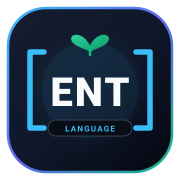
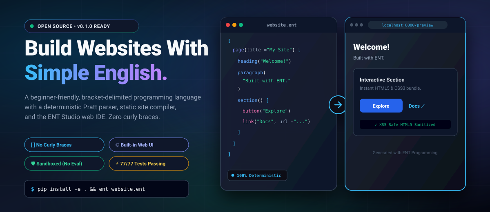
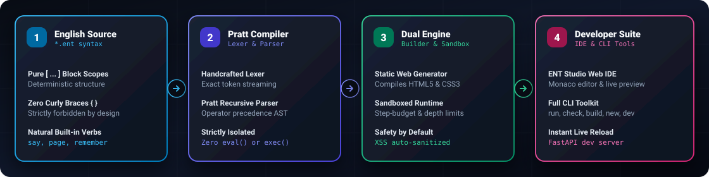
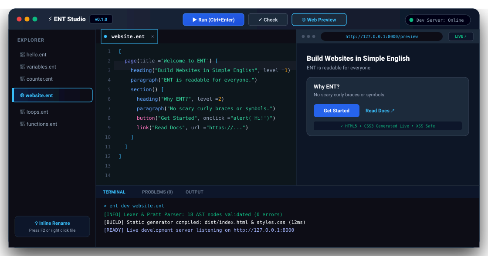

<div align="center">

  

  # ENT Programming
  
  **The Beginner-Friendly, English-Readable Programming Language for Modern Website Development.**

  [](https://github.com/mdebabrata2004/ent-programming/actions/workflows/ci.yml)
  [](https://opensource.org/licenses/MIT)
  [](https://www.python.org/downloads/)
  [](https://github.com/mdebabrata2004/ent-programming/actions/workflows/ci.yml)
  [](https://github.com/mdebabrata2004/ent-programming)

  <br />

  <p align="center">
    <a href="#-quick-start-in-60-seconds"><b>⚡ Quick Start</b></a> •
    <a href="#-why-ent-syntax-at-a-glance"><b>🔍 Syntax Spotlight</b></a> •
    <a href="#-how-it-works"><b>⚙️ How It Works</b></a> •
    <a href="#-ent-studio-web-ide"><b>💻 Web IDE</b></a> •
    <a href="#-cli-cheat-sheet"><b>🛠️ CLI Usage</b></a> •
    <a href="#-documentation-index"><b>📚 Docs</b></a>
  </p>

</div>

---

<p align="center">
  
</p>

---

## ⚡ What is ENT in 30 Seconds?

**ENT** is a genuine programming language designed so that **anyone can read code like English and instantly create modern websites**:

| 📖 Human-Readable | 🌐 Web-First Architecture | 🛡️ Pure Compiler & Sandbox |
|---|---|---|
| Natural keywords (`remember`, `say`, `page`). All code blocks use square brackets `[ ... ]`. **Curly braces `{ }` are strictly forbidden.** | Built-in UI primitives (`page`, `heading`, `paragraph`, `button`, `link`, `section`) compiling directly into clean HTML5 & responsive CSS. | Genuine hand-written Lexer, recursive-descent Pratt parser, AST, and step-budget sandbox. **Zero Python `eval()` or `exec()`.** |

---

## 🔍 Why ENT? (Syntax at a Glance)

Traditional programming languages overwhelm beginners with complicated symbols, confusing imports, and nested curly braces. ENT strips away boilerplate while keeping deterministic grammar:

<p align="center">
  
</p>

### 💡 Example: Build a Live Website in 10 Lines

```ent
[
    page(title = "My First ENT Site") [
        heading("Build Websites with Simple English", level = 1)
        paragraph("ENT is readable, intuitive, and fun to write.")

        section() [
            heading("Getting Started", level = 2)
            paragraph("Write simple code and compile straight to production HTML & CSS.")
            button("Click Me", onclick = "alert('Welcome to ENT!')")
            link("Read Documentation", url = "https://github.com/mdebabrata2004/ent-programming")
        ]
    ]
]
```

---

## ⚙️ How It Works

ENT is not a mockup or regex translator. It runs a complete 4-stage compilation and execution engine:

<p align="center">
  
</p>

1. **Source Code (`.ent`)**: Structured block syntax bounded by `[ ... ]`.
2. **Lexer & Pratt Parser**: Converts tokens into a strongly-typed Abstract Syntax Tree (AST).
3. **Dual Execution Engine**:
   - **Static Web Generator**: Translates web nodes into production-ready, XSS-sanitized HTML5 & CSS3.
   - **Runtime Interpreter**: Evaluates expressions, loops, variables, and user functions in an isolated sandbox.
4. **Developer Tools**: Served via the **`ent` CLI** and **ENT Studio Web IDE**.

---

## 💻 ENT Studio Web IDE

ENT includes an official browser-based development environment powered by **Monaco Editor**, live syntax checking, and instant sandboxed web previews:

<p align="center">
  
</p>

### Key IDE Features:
- ✍️ **Monaco Code Editor**: Auto-indentation, bracket pairing, and keyword highlighting.
- 🌐 **Live Web Preview**: Split-screen responsive iframe renders your website in real-time.
- 📁 **File Explorer with Inline Rename**: Press <kbd>F2</kbd> or right-click to safely rename `.ent` files.
- ⚠️ **Instant Diagnostics**: Line & column error highlighting with beginner-friendly suggestions.

---

## 🚀 Quick Start in 60 Seconds

### 1. Installation

```bash
# Clone the repository
git clone https://github.com/mdebabrata2004/ent-programming.git
cd ent-programming

# Install the language engine & CLI in editable mode
pip install -e ".[dev]"
```

Verify your setup:
```bash
ent --version
# Output: ENT Programming Language v0.1.0
```

### 2. Run Hello World

```bash
ent examples/hello.ent
# Output: Hello, World!
```

### 3. Launch Development Server & Web IDE

```bash
# Start local live server with your website
ent dev examples/website.ent
```
*Open **`http://127.0.0.1:8000`** in your browser to start coding in ENT Studio!*

---

## 🛠️ CLI Cheat Sheet

The `ent` CLI provides a unified workflow for developers:

| Command | Action | Example |
|---|---|---|
| `ent <file.ent>` | Execute an ENT source file in console mode | `ent script.ent` |
| `ent check <file.ent>` | Validate grammar & syntax without running | `ent check website.ent` |
| `ent build <file.ent>` | Compile static HTML5 & CSS website bundle | `ent build website.ent -o dist/` |
| `ent new <name>` | Scaffold a fresh starter ENT website project | `ent new my-portfolio` |
| `ent dev [file.ent]` | Start dev server with instant live web preview | `ent dev website.ent` |
| `ent repl` | Start interactive conversational REPL shell | `ent repl` |
| `ent --version` | Display current engine and CLI version | `ent --version` |

---

## 🧪 Verified Automated Tests

The entire codebase is strictly covered with **77 automated tests** running on every commit:

```bash
# Run all tests (unit, security sandbox, CLI, and API integration)
python -m pytest -v
```

```text
============================= 77 passed in 0.72s =============================
✓ tests/unit/test_lexer.py (8 passed)
✓ tests/unit/test_parser.py (12 passed)
✓ tests/unit/test_interpreter.py (12 passed)
✓ tests/unit/test_web_builder.py (3 passed)
✓ tests/security/test_sandbox.py (5 passed - quotas, recursion, no eval)
✓ tests/integration/test_cli.py (12 passed - all subcommands & exit codes)
✓ tests/integration/test_file_rename.py (15 passed - all security edge cases)
✓ tests/integration/test_server_api.py (8 passed - FastAPI endpoints)
```

---

## 📚 Documentation Index

Ready to explore deeper? Everything is documented in [`docs/`](docs/):

| Document | Purpose |
|---|---|
| 📖 [**Language Specification**](docs/LANGUAGE_SPEC.md) | Syntax rules, types, statements, loops, functions, and standard built-ins. |
| 📐 [**Formal EBNF Grammar**](docs/GRAMMAR.md) | Concrete deterministic grammar specification. |
| 🌐 [**Web Development Guide**](docs/WEB_DEVELOPMENT.md) | How to build UI components (`heading`, `button`, `section`, etc.). |
| 💻 [**ENT Studio IDE Guide**](docs/IDE.md) | Complete workflow, shortcuts (<kbd>Ctrl+Enter</kbd>, <kbd>F2</kbd>), and server architecture. |
| 🛠️ [**CLI Reference**](docs/CLI.md) | Comprehensive flag and subcommand documentation. |
| 🛡️ [**Security Architecture**](docs/SECURITY.md) | Sandboxing rules, XSS protection, and execution quotas. |
| 🏗️ [**Compiler Internals**](docs/ARCHITECTURE.md) | Engineering design of the Lexer, Pratt Parser, AST, and Evaluator. |
| ❓ [**Frequently Asked Questions**](docs/FAQ.md) | Common questions and troubleshooting tips. |

---

## 👤 Author & Maintainer

**Debabrata Mondal**
- GitHub: [@mdebabrata2004](https://github.com/mdebabrata2004)
- Portfolio: [debabratamondal-portfolio.web.app](https://debabratamondal-portfolio.web.app)
- Email: [m.debabrata3773@gmail.com](mailto:m.debabrata3773@gmail.com)

---

## 📄 License

This project is licensed under the [MIT License](LICENSE) — free to use, modify, and distribute.
